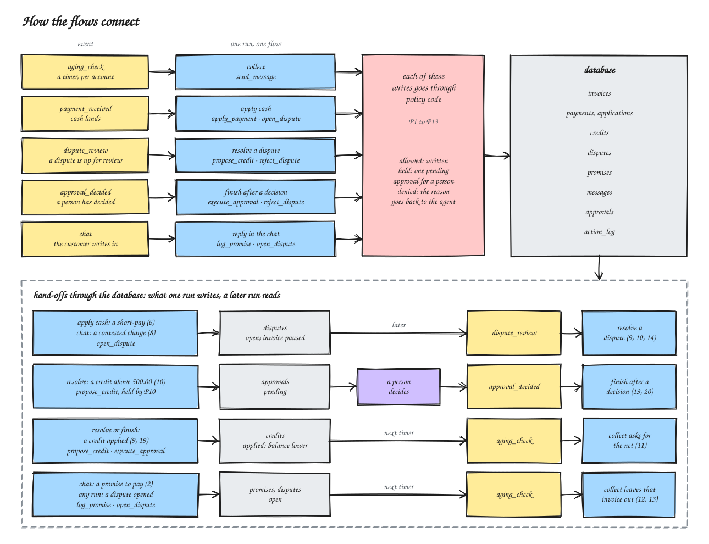

# agent-pydantic

An AI coworker for accounts receivable, built with [Pydantic AI](https://pydantic.dev/docs/ai/overview/).
It handles collections reminders, cash application, and disputes and deductions for one tenant.
The eval set is built first and is the specification for the agent that follows.


## Status

The agent, the eval runner and a saved baseline exist.

- Built: [design](docs/ar-coworker-design.md), [implementation plan](docs/ar-coworker-implementation.md),
  synthetic AR database, eval set of 20 tasks, data model and ledger, 15 policy rules, 17 tools,
  the agent (one Pydantic AI orchestrator on Opus 5.5 with three skills loaded on demand), and the
  eval runner.
- Baseline (`evals/ar_baseline.json`): all 20 tasks pass on each of 4 trials, 80 runs in all, at
  about $0.10 and 7 seconds per run.
- What that does and does not show: the agent follows the rulebook reliably on these scenarios. A
  perfect score also means the set no longer separates a good agent from a better one. Harder
  tasks are the next step; see "not covered yet" in [the flows page](docs/ar-flows.md).

## Setup

Needs [uv](https://docs.astral.sh/uv/) and Python 3.13. `uv run` creates the environment on first use.

A `.env` with `ANTHROPIC_API_KEY` is needed only for live runs. The tests do not call a model.

## Run

```bash
uv run pytest             # offline tests, no API key
uv run pytest --cov=ar --cov=evals
```

These call a real model and need `ANTHROPIC_API_KEY` in `.env`:

```bash
uv run python -m evals.ar_evals                        # all 20 tasks, one trial; prints the grid
uv run python -m evals.ar_evals --trials 4             # pass^4
uv run python -m evals.ar_evals --split never_events
uv run python -m evals.ar_evals --task task_04 task_10
uv run python -m evals.ar_evals --retrieval golden     # none | golden | search
uv run python -m evals.ar_evals --judge                # also score tone, on Sonnet
uv run python -m evals.ar_evals --task task_11 --trace # also what the agent did in each trial
uv run pytest -m e2e                                   # two live agent tests
```

`--trace` prints, under each task, every trial step by step: the event (or each clerk message), each tool call
with its arguments and outcome (a result, `DENIED` by a rule, or `HELD` for a person), the agent's reply, the rows
it wrote, and, for a failed trial, the failed assertions and the diff against the target.

One task costs about $0.10 on Opus 5.5.

## The eval set

- 20 tasks in [tau2-bench](https://github.com/sierra-research/tau2-bench)'s task schema. The format
  is tau2's; the tasks and data are written for this repo and are synthetic.
- A `never_events` split (9 tasks) of forbidden actions, plus `base` (all 20) and `cross_skill`.
- Each task is labelled with its skill, expected disposition and whether a person must be involved.

Details are in [`db/README.md`](db/README.md) and section 2 of the
[implementation plan](docs/ar-coworker-implementation.md). The design is in
[`docs/ar-coworker-design.md`](docs/ar-coworker-design.md).

## Flows

Each event starts one run for one account: an aging check, a payment received, a dispute to
review, a decision on an approval, or a chat with someone at the customer. The agent proposes
writes and policy code decides whether each one happens; runs hand work to each other only
through the database. [`docs/ar-flows.md`](docs/ar-flows.md) has a diagram for every flow and its
endings, each tied to an eval task. They describe what the tasks specify; the agent is not built yet.



## Layout

- `docs/`: design, its diagram, the implementation plan, the flows of every event with their
  diagrams, and a walk-through of one event
- `db/`: database, tasks, splits, policy text and knowledge documents
- `ar/`: data model, ledger, policy rules, tools, the agent, and the assertions the evals use
- `evals/`: the eval runner (`ar_evals.py` is the command), scoring, the simulated clerk and the tone judge
- `tests/`: offline tests
