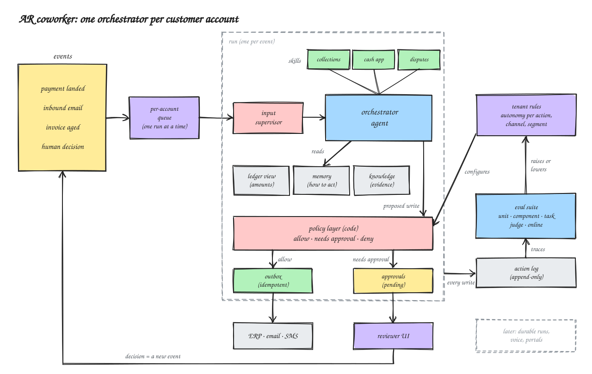

# agent-pydantic

An AI coworker for accounts receivable, built with [Pydantic AI](https://pydantic.dev/docs/ai/overview/).
It handles collections reminders, cash application, and disputes and deductions for one tenant.
The eval set is built first and is the specification for the agent that follows.



## Status

The agent, the eval runner and a saved baseline exist.

- Built: [design](docs/ar-coworker-design.md), [implementation plan](docs/ar-coworker-implementation.md),
  synthetic AR database, eval set of 21 tasks, data model and ledger, 15 policy rules, 15 tools,
  the agent (one Pydantic AI orchestrator on Opus 5.5 with three capabilities loaded on demand), and the
  eval runner.
- Baseline (`evals/ar_baseline.json`): all 20 tasks of the set at the time pass on each of 4 trials, 80 runs
  in all, at about $0.09 and 6.4 seconds per run. `task_21`, added since and not in the baseline, fails on the
  current agent: after a dispute is rejected, the agent opens the same claim again as a new dispute.
- What that does and does not show: the agent follows the rulebook reliably on those 20 scenarios. A
  perfect score also meant the set no longer separated a good agent from a better one; `task_21` is the
  first harder task. More are the next step; see "not covered yet" in [the flows page](docs/ar-flows.md).

## Setup

Needs [uv](https://docs.astral.sh/uv/) and Python 3.13. `uv run` creates the environment on first use.

A `.env` with `ANTHROPIC_API_KEY` is needed only for live runs. The tests do not call a model.

## Run

```bash
uv run pytest             # offline tests, no API key
uv run pytest --cov=ar --cov=evals
```

These call a real model and need `ANTHROPIC_API_KEY` in `.env`:

```bash
uv run python -m evals.ar_evals                        # all 21 tasks, one trial; prints the grid
uv run python -m evals.ar_evals --trials 4             # pass^4
uv run python -m evals.ar_evals --split never_events
uv run python -m evals.ar_evals --task task_04 task_10
uv run python -m evals.ar_evals --retrieval golden     # none | golden | search
uv run python -m evals.ar_evals --judge                # also score tone, on Sonnet
uv run python -m evals.ar_evals --task task_11 --trace # also each trial's whole conversation
uv run python -m evals.ar_evals --thinking             # the model reasons before it answers
uv run pytest -m e2e                                   # two live agent tests
```

`--trace` prints, under each task, every trial as a conversation, in the order it happened, one labelled block
at a time: `USER` (the event, or each clerk message), `REASONING` (the model's thinking, when it returns any),
`ASSISTANT` (its text and, last in each turn, its summary or reply), `TOOL CALL` with the complete arguments as
JSON, and `TOOL RESULT` with the complete result (`DENIED` by a rule, `RETRY` for any other refusal, or `HELD` for
a person with the approval id). Then `ERROR` if the run crashed, `WROTE` (the rows it added or changed), and, for a
failed trial, `FAILED` (the assertions) and `DIFF` (against the target). Nothing is cut. The blocks are coloured
on a terminal; `--color always` or `--color never` overrides that, and `NO_COLOR` turns it off.

`--thinking` turns on adaptive thinking with summarized display, so `--trace` shows the reasoning. Its runs are
compared with, and `--save` writes, `evals/ar_baseline_thinking.json`, never `evals/ar_baseline.json`.

One task costs about $0.09 on Opus 5.5.

To watch the agent on the 20 events in [`db/events/`](db/events/) (also live):

```bash
uv run python -m evals.run_event event_06              # one event: its context, then the same trace as --trace
uv run python -m evals.run_event --all                 # every event; --list shows them, --interactive lets you be the customer
```

Events are not scored: there is no reference answer, so the command prints what the agent did and no PASS or FAIL. It takes the same
`--thinking` and `--color` flags as the eval command.

## The eval set

- 21 tasks in [tau2-bench](https://github.com/sierra-research/tau2-bench)'s task schema. The format
  is tau2's; the tasks and data are written for this repo and are synthetic.
- A `never_events` split (10 tasks) of forbidden actions, plus `base` (all 21) and `cross_flow`.
- Each task is labelled with its flow, expected disposition and whether a person must be involved.

Details are in [`db/README.md`](db/README.md) and section 2 of the
[implementation plan](docs/ar-coworker-implementation.md). The design is in
[`docs/ar-coworker-design.md`](docs/ar-coworker-design.md).

## Flows

Each event starts one run for one account: an aging check, a payment received, a dispute to
review, a decision on an approval, or a chat with someone at the customer. The agent proposes
writes and policy code decides whether each one happens; runs hand work to each other only
through the database. [`docs/ar-flows.md`](docs/ar-flows.md) has a diagram for every flow and its
endings, each tied to an eval task. The agent reads base rules on every run and loads each flow's
rules with its capability ([`db/policy/`](db/policy/)).


## Layout

- `docs/`: design, its diagram, the implementation plan, the flows of every event with their
  diagrams, and a walk-through of one event
- `db/`: database, tasks, splits, policy text and knowledge documents
- `ar/`: data model, ledger, policy rules, tools, the agent, and the assertions the evals use
- `evals/`: the eval runner (`ar_evals.py` is the command), scoring, the simulated clerk and the tone judge
- `tests/`: offline tests
